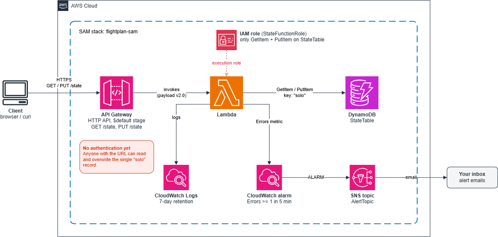

# Flight Plan on AWS
A personal study tracker to learn AWS and GenAI and go from beginner to advanced level. This tracker is being built on AWS using serverless resources. 

## What works today
Saving and loading progress through an HTTP API, with Lambda and DynamoDB behind it, all deployed from one SAM template.

## What's next
- Full web page 
- Authentication and login

## Stack
- API Gateway (HTTP API)
- Lambda (Python 3.14)
- DynamoDB
- CloudWatch (logs, error alarm)
- SNS (alert emails)
- SAM
- IAM (Roles)

## Architecture

## Design decisions
- **HTTP API instead of REST API**: HTTP API is much simpler. REST API has extras like API Keys and usage plans which are not required. HTTP API is also cheaper.
- **DynamoDB provisioned instead of on-demand**: provisioned 2 read / 5 write. It fits inside the free tier so it costs $0. More than 5KB of saves per second gets throttled and the free tier's 25 units are shared across all tables in one region.
- **Partition key "email", one item per user**: every request means "load or save one user's progress", so each user gets one item holding all of it, found instantly by its key. The catch: you cannot ask a question across users (for example, "who finished Leg 1?") without a Scan, which reads every item in the table. Until login exists, the code uses one fixed key instead of an email (see below).
- **A fixed "solo" key instead of taking the email from the request**: with no login yet, an email sent in the request could be anyone's, so a stranger could send yours and read or overwrite your progress. With one fixed key, everyone shares a single test record and nobody can target a real person's data. The catch: there is no per-user data until real authentication is in place.
- **Only "GetItem" + "PutItem" on one table, not a managed policy**: following least-privilege policy, no broad permissions are required. Any new feature, like delete, needs a policy change first though.

## Limitations
- **No authentication**: anyone with the URL can read or overwrite the record. **Fix**: Add login (e.g. Cognito) and an authorizer on the API.
- **One shared "solo" record so no per-user data**: **Fix**: key by the verified user ID once login exists.
- **No CORS**: a web page on another domain can't call the API yet. **Fix**: add CORS settings to the HTTP API.
- **The whole state is one item, so it can't grow past 400 KB**: **Fix**: split it into several items if it ever gets big.
